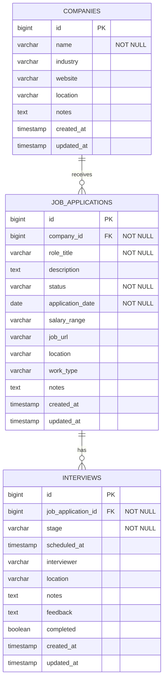

# 📋 Job Application Tracking System

[](https://github.com/pri-1207/job-application-tracker/actions/workflows/ci.yml)
[](https://pri-1207.github.io/job-application-tracker/)
[](https://www.oracle.com/java/)
[](https://spring.io/projects/spring-boot)
[](https://www.postgresql.org/)
[](LICENSE)
[](https://github.com/pri-1207/job-application-tracker/releases)

A production-grade, enterprise-ready **RESTful Backend System** built with **Java 17, Spring Boot, Spring Data JPA, and PostgreSQL** designed to organize and streamline the end-to-end recruitment lifecycle. Manage target companies, monitor application progression across stages, schedule multi-round interviews, and execute dynamic multi-criteria searches with pagination and sorting.

🌐 **Live Documentation Site**: [https://pri-1207.github.io/job-application-tracker/](https://pri-1207.github.io/job-application-tracker/)  
📖 **Interactive Swagger UI**: `http://localhost:8080/swagger-ui.html`

---

## 📑 Table of Contents
- [Key Features](#-key-features)
- [Architecture & Tech Stack](#-architecture--tech-stack)
- [Database Schema & ER Diagram](#-database-schema--er-diagram)
- [Project Structure](#-project-structure)
- [API Reference](#-api-reference)
  - [Company Endpoints](#1-companies-apiv1companies)
  - [Job Application Endpoints](#2-job-applications-apiv1applications)
  - [Interview Endpoints](#3-interviews-apiv1interviews)
- [Dynamic Filtering & Sorting Guide](#-dynamic-filtering--sorting-guide)
- [Validation & Centralized Exception Handling](#-validation--centralized-exception-handling)
- [CI/CD & GitHub Pages](#-cicd--github-pages)
- [Version Control Strategy](#-version-control-strategy)
- [Getting Started](#-getting-started)
  - [Prerequisites](#prerequisites)
  - [Local Setup with Docker](#local-setup-with-docker)
  - [Running the Application](#running-the-application)
  - [Executing Tests](#executing-tests)
- [Changelog & Patch Notes](#-changelog--patch-notes)
- [Contributing & License](#-contributing--license)

---

## 🌟 Key Features

- **Robust RESTful Architecture**: Clean separation of concerns following industry-standard layered architecture (Controller $\rightarrow$ Service $\rightarrow$ Repository $\rightarrow$ Database).
- **Relational Data Modeling with PostgreSQL**: Entities with bidirectional and unidirectional mappings (`Company`, `JobApplication`, `Interview`), cascading operations, and orphan removal.
- **Dynamic Filtering & Pagination**: Multi-parameter search supporting filtering by `status`, `companyId`, `roleTitle` (fuzzy/partial match), and `applicationDate` range (`startDate` to `endDate`) with custom sorting (`sortBy`, `sortDir`).
- **Comprehensive Lifecycle Tracking**:
  - **10 Application Statuses**: `APPLIED`, `UNDER_REVIEW`, `PHONE_SCREEN`, `INTERVIEWING`, `TECHNICAL_ASSESSMENT`, `OFFER_RECEIVED`, `OFFER_ACCEPTED`, `OFFER_DECLINED`, `REJECTED`, `WITHDRAWN`.
  - **9 Interview Stages**: `PHONE_SCREENING`, `FIRST_ROUND`, `SECOND_ROUND`, `TECHNICAL`, `BEHAVIORAL`, `ONSITE`, `HIRING_MANAGER`, `PANEL`, `FINAL_ROUND`.
- **Request Validation**: Jakarta / Hibernate Bean Validation on payload bodies to guarantee data integrity before processing.
- **Centralized Exception Handling**: Global exception handler (`@RestControllerAdvice`) delivering consistent, machine-readable `ApiErrorResponse` JSON schemas with HTTP status codes and field-level validation feedback.
- **Automated CI/CD**: Dual workflows for automated test verification on push/PR, release packaging, and automatic GitHub Pages deployment.

---

## 🏗️ Architecture & Tech Stack

```
+-----------------------------------------------------------+
|                      Client Layer                         |
|      (Frontend / Swagger UI / GitHub Pages / cURL)        |
+-----------------------------+-----------------------------+
                              | JSON / HTTP
                              v
+-----------------------------------------------------------+
|                    Controller Layer                       |
|   CompanyController | JobApplicationController | Interview|
|          - Route handling, validation (@Valid), DTOs      |
+-----------------------------+-----------------------------+
                              |
                              v
+-----------------------------------------------------------+
|                      Service Layer                        |
|       CompanyService | JobApplicationService | Interview  |
|          - Business logic, transactions (@Transactional)  |
+-----------------------------+-----------------------------+
                              |
                              v
+-----------------------------------------------------------+
|                     Repository Layer                      |
|       Spring Data JPA | JpaSpecificationExecutor | JPQL   |
+-----------------------------+-----------------------------+
                              |
                              v
+-----------------------------------------------------------+
|                     Database Layer                        |
|           PostgreSQL 16 (H2 In-Memory for Tests)          |
+-----------------------------------------------------------+
```

| Component | Technology | Version | Description |
|---|---|---|---|
| **Language** | Java (OpenJDK) | 17 LTS | Core programming language |
| **Framework** | Spring Boot | 3.2.5 | Enterprise application framework |
| **ORM / Data Access** | Spring Data JPA / Hibernate | 3.2.5 | Object-relational mapping and data persistence |
| **Database** | PostgreSQL | 16 | Primary production relational database |
| **Testing DB** | H2 Database | 2.2.x | In-memory embedded database for isolated testing |
| **Validation** | Jakarta Bean Validation | 3.0.x | Input constraint and payload validation |
| **API Docs** | SpringDoc OpenAPI (Swagger UI) | 2.5.0 | Interactive API specification and testing tool |
| **Productivity** | Project Lombok | 1.18.x | Boilerplate reduction (getters, setters, builders) |
| **Build Tool** | Apache Maven | 3.9.6 | Dependency management and build lifecycle |
| **CI/CD** | GitHub Actions | v4 | Automated testing, packaging, and deployment |

---

## 🗄️ Database Schema & ER Diagram



---

## 📁 Project Structure

```
job-application-tracker/
├── .github/
│   ├── workflows/
│   │   ├── ci.yml                 # Continuous Integration: build & test matrix
│   │   ├── release.yml            # Continuous Deployment: GitHub releases on tags
│   │   └── pages.yml              # Documentation deploy to GitHub Pages
│   └── PULL_REQUEST_TEMPLATE.md   # Standardized PR checklist
├── .mvn/
│   └── wrapper/
│       └── maven-wrapper.properties
├── docs/
│   └── index.html                 # GitHub Pages static documentation dashboard
├── src/
│   ├── main/
│   │   ├── java/com/jobtracker/
│   │   │   ├── config/
│   │   │   │   └── OpenApiConfig.java          # Swagger OpenAPI documentation bean
│   │   │   ├── controller/
│   │   │   │   ├── CompanyController.java       # Company endpoints
│   │   │   │   ├── JobApplicationController.java# Application endpoints & filters
│   │   │   │   └── InterviewController.java    # Interview scheduling endpoints
│   │   │   ├── dto/
│   │   │   │   ├── ApiErrorResponse.java        # Standardized error envelope
│   │   │   │   ├── CompanyDTO.java              # Validated company DTO
│   │   │   │   ├── JobApplicationDTO.java       # Validated application DTO
│   │   │   │   └── InterviewDTO.java            # Validated interview DTO
│   │   │   ├── exception/
│   │   │   │   ├── BadRequestException.java     # 400 Runtime exception
│   │   │   │   ├── GlobalExceptionHandler.java  # Centralized exception handler
│   │   │   │   └── ResourceNotFoundException.java # 404 Runtime exception
│   │   │   ├── model/
│   │   │   │   ├── ApplicationStatus.java       # 10 application status states
│   │   │   │   ├── Company.java                 # Company JPA entity
│   │   │   │   ├── Interview.java               # Interview JPA entity
│   │   │   │   ├── InterviewStage.java          # 9 interview stage states
│   │   │   │   └── JobApplication.java          # JobApplication JPA entity
│   │   │   ├── repository/
│   │   │   │   ├── CompanyRepository.java       # Company query methods
│   │   │   │   ├── InterviewRepository.java     # Interview query methods
│   │   │   │   └── JobApplicationRepository.java# Custom JPQL and specifications
│   │   │   ├── service/
│   │   │   │   ├── CompanyService.java          # Business logic for companies
│   │   │   │   ├── InterviewService.java        # Business logic for interviews
│   │   │   │   └── JobApplicationService.java   # Filtering, sorting & logic
│   │   │   └── JobApplicationTrackerApplication.java
│   │   └── resources/
│   │       └── application.properties           # PostgreSQL and Spring configurations
│   └── test/
│       ├── java/com/jobtracker/
│       │   ├── controller/
│       │   │   └── CompanyControllerTest.java   # MockMvc WebMvc unit tests
│       │   └── JobApplicationTrackerApplicationTests.java
│       └── resources/
│           └── application-test.properties      # H2 in-memory test configuration
├── CHANGELOG.md                   # Patch notes and release history
├── CONTRIBUTING.md                # Collaboration and contribution guidelines
├── docker-compose.yml             # Local PostgreSQL service definition
├── LICENSE                        # MIT License
├── mvnw                           # Maven Wrapper executable (Unix)
├── mvnw.cmd                       # Maven Wrapper executable (Windows)
├── pom.xml                        # Maven dependencies & build configurations
└── README.md                      # Primary project documentation
```

---

## 🚀 API Reference

Base URI: `http://localhost:8080/api/v1`

### 1. Companies (`/api/v1/companies`)

| Method | Endpoint | Description | Status Code |
|---|---|---|---|
| `GET` | `/api/v1/companies` | List all companies (optional sort: `sortBy`, `sortDir`) | `200 OK` |
| `GET` | `/api/v1/companies/{id}` | Get company details by ID | `200 OK` / `404 Not Found` |
| `GET` | `/api/v1/companies/search?name={name}` | Search companies by partial name | `200 OK` |
| `POST` | `/api/v1/companies` | Create a new company record | `201 Created` / `400 Bad Request` |
| `PUT` | `/api/v1/companies/{id}` | Update company details by ID | `200 OK` / `404 Not Found` |
| `DELETE` | `/api/v1/companies/{id}` | Delete company and cascade applications | `204 No Content` / `404 Not Found` |

### 2. Job Applications (`/api/v1/applications`)

| Method | Endpoint | Description | Status Code |
|---|---|---|---|
| `GET` | `/api/v1/applications` | Paginated applications list (`page`, `size`, `sortBy`, `sortDir`) | `200 OK` |
| `GET` | `/api/v1/applications/{id}` | Get application by ID | `200 OK` / `404 Not Found` |
| `GET` | `/api/v1/applications/filter` | **Dynamic search** by status, company, role, dates | `200 OK` |
| `GET` | `/api/v1/applications/status/{status}` | Filter applications by exact status enum | `200 OK` |
| `GET` | `/api/v1/applications/count/{status}` | Get application metrics/count by status | `200 OK` |
| `POST` | `/api/v1/applications` | Create a new job application | `201 Created` / `400 Bad Request` |
| `PUT` | `/api/v1/applications/{id}` | Update an existing job application | `200 OK` / `404 Not Found` |
| `PATCH` | `/api/v1/applications/{id}/status` | Quick-update status enum only | `200 OK` / `404 Not Found` |
| `DELETE` | `/api/v1/applications/{id}` | Delete application by ID | `204 No Content` / `404 Not Found` |

### 3. Interviews (`/api/v1/interviews`)

| Method | Endpoint | Description | Status Code |
|---|---|---|---|
| `GET` | `/api/v1/interviews` | List all scheduled interviews | `200 OK` |
| `GET` | `/api/v1/interviews/{id}` | Get interview details by ID | `200 OK` / `404 Not Found` |
| `GET` | `/api/v1/interviews/application/{appId}` | List interviews for a specific application | `200 OK` |
| `GET` | `/api/v1/interviews/upcoming` | List upcoming interviews sorted by date | `200 OK` |
| `POST` | `/api/v1/interviews` | Schedule a new interview round | `201 Created` / `400 Bad Request` |
| `PUT` | `/api/v1/interviews/{id}` | Update interview details or outcome | `200 OK` / `404 Not Found` |
| `DELETE` | `/api/v1/interviews/{id}` | Delete an interview | `204 No Content` / `404 Not Found` |

---

## 🔍 Dynamic Filtering & Sorting Guide

The system provides flexible filtering via the dedicated filter endpoint:
`GET /api/v1/applications/filter`

### Available Filter Query Parameters

| Parameter | Type | Required | Default | Description | Example |
|---|---|---|---|---|---|
| `status` | `ApplicationStatus` | No | `null` | Exact status match | `INTERVIEWING` |
| `companyId` | `Long` | No | `null` | Filter by associated company ID | `1` |
| `roleTitle` | `String` | No | `null` | Case-insensitive substring match | `Backend` |
| `startDate` | `LocalDate` (`YYYY-MM-DD`) | No | `null` | Lower bound for application date | `2026-01-01` |
| `endDate` | `LocalDate` (`YYYY-MM-DD`) | No | `null` | Upper bound for application date | `2026-12-31` |
| `page` | `int` | No | `0` | Zero-indexed page number | `0` |
| `size` | `int` | No | `20` | Items per page | `10` |
| `sortBy` | `String` | No | `applicationDate` | Field to sort by (`roleTitle`, `applicationDate`, etc.) | `applicationDate` |
| `sortDir` | `String` | No | `desc` | Direction (`asc` or `desc`) | `asc` |

### Example cURL Queries

#### 1. Filter applications in 'INTERVIEWING' status sorted by application date:
```bash
curl -X GET "http://localhost:8080/api/v1/applications/filter?status=INTERVIEWING&sortBy=applicationDate&sortDir=desc&page=0&size=10"
```

#### 2. Search applications by role title and date range:
```bash
curl -X GET "http://localhost:8080/api/v1/applications/filter?roleTitle=Engineer&startDate=2026-01-01&endDate=2026-06-30"
```

#### 3. Update application status via PATCH:
```bash
curl -X PATCH "http://localhost:8080/api/v1/applications/1/status" \
     -H "Content-Type: application/json" \
     -d '{"status": "OFFER_RECEIVED"}'
```

---

## 🛡️ Validation & Centralized Exception Handling

All incoming requests are validated using **Jakarta Bean Validation**. In the event of validation errors or runtime exceptions, the application produces a standardized JSON response format.

### Standardized Error Envelope (`ApiErrorResponse`)
```json
{
  "status": 400,
  "error": "Bad Request",
  "message": "Validation failed",
  "path": "/api/v1/applications",
  "timestamp": "2026-10-14T17:30:00",
  "validationErrors": {
    "roleTitle": "Role title is required",
    "applicationDate": "Application date is required",
    "companyId": "Company ID is required"
  }
}
```

### Resource Not Found (404)
```json
{
  "status": 404,
  "error": "Not Found",
  "message": "Job Application not found with id: 99",
  "path": "/api/v1/applications/99",
  "timestamp": "2026-10-14T17:30:00",
  "validationErrors": null
}
```

---

## 🔄 CI/CD & GitHub Pages

This repository includes automated GitHub Actions workflows:

1. **Continuous Integration (`.github/workflows/ci.yml`)**:
   - Triggers on all pushes and PRs to `main` and `develop`.
   - Spins up a temporary PostgreSQL service container.
   - Sets up JDK 17 with Temurin distribution and Maven caching.
   - Runs the test suite using in-memory H2 database.
   - Packages and uploads executable JAR artifacts.

2. **Continuous Deployment / Releases (`.github/workflows/release.yml`)**:
   - Triggers when tags matching `v*.*.*` are pushed.
   - Compiles and packages release JAR binaries.
   - Automatically generates changelog release notes.
   - Creates a published **GitHub Release** with executable JAR attachments.

3. **Documentation Deployment (`.github/workflows/pages.yml`)**:
   - Triggers on pushes modifying `docs/**`.
   - Deploys the static responsive API documentation site to **GitHub Pages**.

---

## 🌿 Version Control Strategy

The project adheres to **GitFlow** conventions:

- `main`: Production-ready branch. Releases and hotfixes are merged here.
- `develop`: Nightly / feature integration branch.
- `feature/*`: Dedicated branches for distinct capabilities (e.g., `feature/jwt-auth`).
- `bugfix/*`: Targeted patches addressing tracked issues.
- `v1.0.0`, `v1.1.0`: Semantic release tags triggering automated CD builds.

---

## ⚡ Getting Started

### Prerequisites
- **Java 17 JDK** or higher
- **PostgreSQL 14+** (or Docker to run PostgreSQL container)
- **Git**

### Local Setup with Docker

1. **Clone the repository**:
   ```bash
   git clone https://github.com/pri-1207/job-application-tracker.git
   cd job-application-tracker
   ```

2. **Spin up PostgreSQL via Docker Compose**:
   ```bash
   docker compose up -d
   ```
   *This starts PostgreSQL on port `5432` with database `job_tracker_db`, user `postgres`, and password `postgres`.*

### Running the Application

Using the included Maven wrapper:

- **Linux / macOS**:
  ```bash
  ./mvnw spring-boot:run
  ```
- **Windows**:
  ```cmd
  mvnw.cmd spring-boot:run
  ```

The server will initialize on port `8080`.

- Access API root: `http://localhost:8080/api/v1/applications`
- Access Swagger Documentation: `http://localhost:8080/swagger-ui.html`
- Health check: `http://localhost:8080/actuator/health`

### Executing Tests

Run unit and integration tests using the isolated H2 in-memory test configuration:
```bash
./mvnw clean test
```

---

## 📝 Changelog & Patch Notes

Full patch notes are recorded in [CHANGELOG.md](CHANGELOG.md).

- **v1.0.0 (2026-10-14)**:
  - Initial public release.
  - Complete RESTful endpoints for Applications, Companies, and Interviews.
  - Spring Data JPA with dynamic filtering, pagination, and multi-directional sorting.
  - Bean Validation and centralized `@RestControllerAdvice` error handling.
  - Interactive Swagger UI and GitHub Pages documentation site.
  - Full CI/CD pipelines (CI test matrix, CD releases, Pages deployment).

---

## 🤝 Contributing & License

Contributions are welcome! Please read [CONTRIBUTING.md](CONTRIBUTING.md) for details on our code of conduct, branching model, and pull request submission guidelines.

Distributed under the **MIT License**. See [LICENSE](LICENSE) for more details.

---

**Developed with ❤️ by [pri-1207](https://github.com/pri-1207)**
